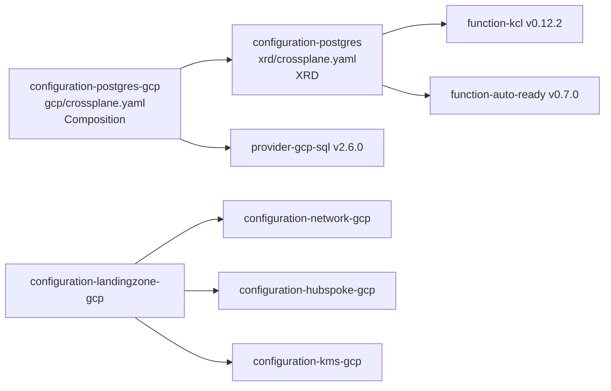

# Crossplane Configuration packages

`xrd/providers.yaml` lists every provider of every backend of a module, so
installing a module that way installs all of them: `postgres` brings RDS, Cloud
SQL, Azure Flexible Server and provider-helm even when the cluster only runs
CloudNativePG. Configuration packages hand that decision to Crossplane's
package manager. A cluster installs the backend it uses, and Crossplane
installs exactly what that backend depends on.



## Two packages per layer

| Package | Meta file | Contents | Depends on | Version |
|---|---|---|---|---|
| `configuration-<module>` | `xrd/crossplane.yaml` | `xrd.yaml` | the Functions in `xrd/functions.yaml` | `pkg.example.org/version` annotation |
| `configuration-<module>-<backend>` | `<backend>/crossplane.yaml` | `composition.yaml` | the base package, its Providers, the configurations of any XR it composes | `<backend>/kcl.mod` (nx release); the annotation when the backend has no kcl.mod |

The base is a separate package because two packages cannot own the same XRD:
`postgres-gcp` and `postgres-cnpg` both depend on `configuration-postgres`,
so one cluster can run both. Configuration dependencies are floors
(`>=0.1.0`), so a base can move without republishing its backends.

## Where dependencies come from

`tools/configurations.sh sync` derives what it can from each backend's
`kcl.mod`:

- **A path dependency on `packages/providers/<name>`** adds the Provider that
  `registry.yaml` row installs (`install: none` rows add nothing).
- **A path dependency on another module's `xrd` package** adds that module's
  configuration. When that module has a backend with the same name, it adds
  that backend instead (the XR is composed with
  `compositionSelector.matchLabels.provider: <backend>`). `landingzone-gcp`
  therefore depends on `network-gcp`, `hubspoke-gcp` and `kms-gcp`.

What kcl.mod cannot show is written by hand, with a comment, in the backend's
`crossplane.yaml`:

| Backend | Hand-written dependency | Why |
|---|---|---|
| `postgres-cnpg`, `backup-velero`, `kms-openbao` | provider-helm | `xrd/providerconfigs.yaml` installs the operator as a helm Release |
| `kms-oci` | provider-family-oci | owns the ProviderConfig `provider-oci-kms` authenticates through |
| `postgres-vm` | `configuration-vm` | composes a VirtualMachine XR; its backend is picked at runtime |
| `project-composite` | the postgres, redis, queue, bucket, registry and workload-identity bases | child XRs composed by kind |
| `package-registry-*` | the backend's providers | rendered by function-package-registry, not KCL |

`sync` never removes a dependency. It adds missing ones and moves Provider and
Function versions to `registry.yaml` / `functions.yaml`.

## Versions

- **A backend with a kcl.mod** has its version set by nx release. Changing
  its `crossplane.yaml` makes the project affected, so the next release bumps
  it, and `composition.yaml` is pinned to the same version.
- **A base package, or a backend without kcl.mod,** carries
  `pkg.example.org/version` and `pkg.example.org/digest`. The digest covers
  the payload (`xrd.yaml` / `composition.yaml`) plus the meta file without the
  digest. `check` fails when they no longer match, and
  `just configurations-bump <package> [patch|minor|major]` moves both.

## Commands

```bash
just configurations [module]           # packages, versions, dependencies
just configurations-sync [module]      # create / refresh crossplane.yaml files
just configurations-check              # drift (CI runs it)
just configurations-bump <package>     # version a self-versioned package
just configurations-build [filter]     # xpkgs into tmp/xpkg/configurations/
just configuration <module> <backend>  # local e2e: install one backend as a package
```

`check` fails when any of these is true:

- a `crossplane.yaml` is missing;
- a dependency kcl.mod implies is missing;
- a Provider or Function version is not what `registry.yaml` / `functions.yaml`
  pins, or is not a semver tag (`latest` never resolves);
- a Provider is not a `registry.yaml` install ref of that module;
- a Configuration dependency is not one of this repo's packages, or requires
  a higher version than the package has;
- a self-versioned package's digest is stale;
- a Composition's `compositeTypeRef` does not match its module's XRD.

## Installing on a cluster

1. **Runtime prerequisites first:** `tools/configurations.sh runtime <module>`.
   This is `xrd/providers.yaml` without its Providers (ServiceAccounts, RBAC,
   DeploymentRuntimeConfigs), plus an `ImageConfig` for every Provider that
   sets a `runtimeConfigRef`. A Provider installed as a dependency has no
   `runtimeConfigRef` of its own, so the ImageConfig (Crossplane >= 2.2) is
   what gives provider-helm its cluster-admin ServiceAccount. Apply it before
   the package: an ImageConfig created later only reaches a revision on that
   revision's next reconcile.
2. **The package:** `tools/configurations.sh manifest <module>-<backend>`
   prints the `pkg.crossplane.io/v1` Configuration. Crossplane installs the
   base, the Functions and the Providers.
3. **ProviderConfigs:** `tools/configurations.sh providerconfigs <module>`
   prints the `xrd/providerconfigs.yaml` documents whose kinds the cluster now
   serves. The helm Releases of a backend that did not install provider-helm
   are skipped.

`just configuration <module> <backend>` does all three on the local Kind
cluster. It builds the packages for in-cluster names (Configuration
dependencies from `172.18.0.100:80`, KCL sources from `kind-registry`), pushes
them through `localhost:5001`, and publishes the KCL modules of every package
in the dependency closure.

Do not mix this with `install-module` / `workload` on the same module. The
package manager does not take over an XRD that was applied by hand.

Provider references must match across install paths. The package manager
treats `ghcr.io/crossplane-contrib/provider-gcp-sql` and
`xpkg.crossplane.io/crossplane-contrib/provider-gcp-sql` as different
packages that own the same CRDs. A cluster whose providers are installed some
other way (for example the gitops repo's `platform/crossplane/providers`)
must install them from the same registry `registry.yaml` uses.

## Publishing

The release workflow runs these after the KCL modules are published:

```bash
tools/configurations.sh check
tools/configurations.sh push all --registry "$KCL_REGISTRY" --skip-tagged --tag
```

Each package goes to `<registry>/configuration-<name>:<version>`. A published
version is recorded as the git tag `xpkg/configuration-<name>/<version>`, so
re-runs only push what is new. The tag pattern deliberately avoids
`<pkg>@<version>`, which the workflow reads as the affected base. Docker Hub
creates a repository on first push, with the account's default visibility.
