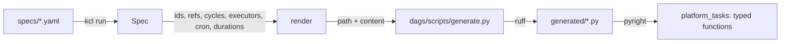

# airflow-dags

Airflow 3 DAG files generated from typed YAML specs. KCL validates the graph
before any Python exists, and the generated Python is written so that a type
checker validates it against the task functions it calls.



## What a spec says

```yaml
executors: [CeleryExecutor, KubernetesExecutor]   # what this Airflow runs
dags:
  - id: nightly_report
    schedule: "0 3 * * *"          # cron, @preset, or unset (manual)
    startDate: "2026-11-01"
    retries: 1
    retryDelay: 2m
    tasks:
      - id: extract                 # also the Python variable: an identifier
        callable: platform_tasks.reports:extract
        kwargs: {source: jira, days: 7}
      - id: transform
        callable: platform_tasks.reports:transform
        inputs: {rows: extract}     # parameter ← upstream return value (XCom)
        executor: KubernetesExecutor
        requests: {cpu: 500m, memory: 1Gi}
      - id: notify
        type: bash
        command: echo done
        upstream: [transform]
```

`callable` names a plain, fully annotated function, not a `@task`. The
generated file wraps it in Airflow's typed TaskFlow form:

```python
if TYPE_CHECKING:  # never runs: the XCom edges as direct calls
    _extract = platform_tasks.reports.extract(source="jira", days=7)
    _transform = platform_tasks.reports.transform(rows=_extract)

with DAG(dag_id="nightly_report", ...):
    extract = task(task_id="extract")(platform_tasks.reports.extract)(source="jira", days=7)
    transform = task(task_id="transform", executor="KubernetesExecutor", executor_config=...)(
        platform_tasks.reports.transform
    )(rows=cast(Any, extract))
    notify = BashOperator(task_id="notify", bash_command="echo done")
    transform >> notify
```

Each check has an owner:

| mistake | caught by |
| --- | --- |
| duplicate dag or task id, a task id that isn't an identifier or shadows an import | `kcl run` |
| `upstream` or `inputs` naming a missing task, a dependency cycle | `kcl run` |
| an executor the cluster doesn't run, a pod override without `KubernetesExecutor` | `kcl run` |
| malformed cron, date or duration | `kcl run` |
| misspelled kwarg, missing argument, wrong literal type | pyright, on the runtime call and the `TYPE_CHECKING` block |
| an upstream return type that doesn't fit the downstream parameter | pyright, on the `TYPE_CHECKING` block |

At parse time an XCom value is an `XComArg`, which matches no parameter type. That's why the
runtime call passes it as `Any`, and the edge is checked in the `TYPE_CHECKING`
block instead.

## Usage

The workspace's `dags` project drives it:

```bash
bun nx run dags:generate               # specs/*.yaml → generated/*.py (ruff-formatted)
bun nx run dags:generate -- --check    # fail if generated/ is stale
bun nx run dags:lint                   # ruff + pyright against Airflow 3.2.2
bun nx run dags:test                   # every DAG file loads in Airflow's DagBag
```

You can also render a spec directly:
`kcl run packages/airflow-dags -D values=<spec.yaml> --format json`. Without a
values file it renders a built-in demo. In code:
`import airflow_dags.lib as dags; dags.render(dags.Spec {**values}, "specs/x.yaml")`.
