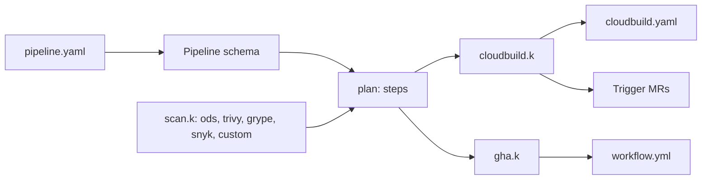

# ci-pipeline

One typed container-image pipeline: pull mirrored base images, build, scan, push. It renders
for each CI that runs it:

| `-D target=` | output | typed against |
| --- | --- | --- |
| `cloudbuild` (default) | Cloud Build config for `gcloud builds submit --config` | Cloud Build's build schema (by construction) |
| `cloudbuild-trigger` | Crossplane `Trigger` MRs, one per event (`<name>-push`, `<name>-pr`), with the build inline | `cloudbuild.gcp.m.upbound.io/v1beta1` in [`providers/gcp-cloudbuild`](../providers/gcp-cloudbuild) |
| `gha` | GitHub Actions workflow, one job | `actionlint` clean |

Tekton (Pipelines-as-Code `PipelineRun`) is the next target. Every step is already a container
with a POSIX script, which is a Tekton step.



## Usage

```bash
# from vendor/kcl-packages
kcl run packages/ci-pipeline/main.k -D values=<pipeline.yaml> -q > cloudbuild.yaml
kcl run packages/ci-pipeline/main.k -D values=<pipeline.yaml> -D target=cloudbuild-trigger -q
kcl run packages/ci-pipeline/main.k -D values=<pipeline.yaml> -D target=gha -q > .github/workflows/<name>.yml
kcl run packages/ci-pipeline/main.k -q   # examples/pipeline.yaml
```

A config file needs the commit: `gcloud builds submit --config cloudbuild.yaml --substitutions=COMMIT_SHA=$(git rev-parse HEAD)`.
Without it, every step stops on the empty `GIT_SHA`.

## Steps

| step | image | does |
| --- | --- | --- |
| `resolve` | `tools.docker` | `image.immutableTags` (default): if `<repository>:<sha>` exists, pull it and mark the build and push steps to skip |
| `pull-base` | `tools.docker` | `docker pull` each `image.baseImages` value **through its mirror** |
| `build` | `tools.docker` | `docker build --platform … --build-arg <ARG>=<mirror ref> … -t <repository>:<sha>` (BuildKit) |
| `export` | `tools.docker` | `docker save` of every target, only when a scanner reads archives |
| `scan-<scanner>-<target>` | the scanner's | report steps first (base images, allowed to fail), then the gate steps (the image) |
| `push` | `tools.docker` | `docker push <repository>:<sha>` |

The tag is the commit sha. Every step gets `GIT_SHA` (Cloud Build `$COMMIT_SHA`, Actions the PR
head, else the pushed sha) and `IMAGE_REPO`, and every script sets `IMAGE` from them. No CI's
expression syntax appears in a script. Cloud Build escapes `$` as `$$`. Actions feeds the script
to `docker run … sh -s` through a quoted heredoc.

**Nothing is pulled from upstream directly.** Every step image and base image is rewritten
through `mirrors`, which maps an upstream registry to an Artifact Registry remote repository.
`rust:1` becomes `<docker.io mirror>/library/rust:1`, and
`gcr.io/distroless/cc-debian12` becomes `<gcr.io mirror>/distroless/cc-debian12`. An image
whose registry has no mirror fails the render (`requireMirror: false` allows direct pulls).
The push target's own registry is the exception. The Dockerfile takes its bases as `ARG`s
whose defaults are the upstream refs, so local builds are unchanged.

## Scanning (`scan.k`)

A scanner is an image plus two shell snippets. `report` prints findings and never fails on
them. `gate` fails at or above `failOn`.

| `use:` | cost | reads | notes |
| --- | --- | --- | --- |
| `ods` | paid per scan | Docker daemon | Google On-Demand Scanning. Needs `ondemandscanning.googleapis.com` in the billed project and `roles/ondemandscanning.admin`. `ODS_LOCATION` env: `us`, `europe` (default) or `asia` |
| `trivy` | free | archive | `--ignore-unfixed` with `ignoreUnfixed` |
| `grype` | free | archive | `-debug` image (busybox shell), runs as nonroot |
| `snyk` | paid | archive | `SNYK_TOKEN` from secret `snyk-token` |
| custom | | | `name`, `image`, `input` (`daemon` or `archive`), `report`, `gate`, optional `shell`, `unfixed`, `env`, `secrets` |

Placeholders: `{ref}` (quote it, since it may be `$IMAGE`), `{archive}`, `{severities}`
(`HIGH,CRITICAL`), `{severityRegex}` (`HIGH|CRITICAL`), `{threshold}` (`high`), `{unfixed}`.
A preset entry can override any field, for example `{use: ods, env: {ODS_LOCATION: us}}`.

| `scan.` | default | |
| --- | --- | --- |
| `failOn` | `CRITICAL` | lowest severity that fails a gate |
| `ignoreUnfixed` | `false` | gate only on fixable findings. Every scanner needs an `unfixed` flag, or the render fails |
| `baseImages` | `report` | `gate`, `report` or `skip` |

Secrets (`secrets: {ENV: <id>}`) come from Secret Manager `projects/$PROJECT_ID/secrets/<id>/versions/latest`
on Cloud Build, and from repository secret `ENV` on Actions.

## Per CI

**Cloud Build.** Steps run sequentially. The push is a step, not `images:`, because an image that
already exists must not be pushed again. The tradeoff: the build records no image digest or
provenance. `cloudBuild.machineType` and `logging` (default `CLOUD_LOGGING_ONLY`, which a
user-specified service account requires) go to `options`. `cloudBuild.trigger` (project, service
account email, `location`, optional 2nd-gen `repository`, `namespace`, `providerConfig`) is
needed only for Trigger output. Fork pull requests wait for `/gcbrun`
(`COMMENTS_ENABLED_FOR_EXTERNAL_CONTRIBUTORS_ONLY`). Branch globs become one RE2 regex, and
`triggers.paths` becomes `includedFiles`.

**GitHub Actions.** Checkout of the PR head, Workload Identity Federation
(`github.workloadIdentityProvider` / `serviceAccount`, defaulting to the `GCP_WIF_PROVIDER` /
`GCP_SA` variables infra `bootstrap` writes), and a `docker login` to each Artifact Registry
host. Each step then runs `docker run` with the runner's Docker socket, a copy of its
`~/.docker`, and the workspace at the same path. Report steps are `continue-on-error`. Fork
pull requests are skipped, because they get no OIDC token.

## Verification

`kcl test` (12 tests). `actionlint` with shellcheck passes on the example's workflow. shellcheck
passes on every script of the example's Cloud Build config.
