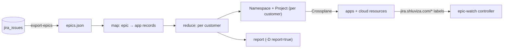

# epics

Jira epics in, tenant apps out: a map-reduce over the epic export of
`atlassian-ingest export-epics`. Every customer named in a deployment epic
becomes a Namespace plus one `Project` XR
([`packages/platform/project`](../platform/project/composite/)), with its apps
from a catalog, the resources those apps need, and its node placement: paying
customers on dedicated nodes, everyone else on the shared pool.



Jira is read-only. Epics are the only issue type read; their existing
statuses are read as they are; nothing is written back.

## Usage

```bash
# from apps/atlassian-ingest (curated catalog env set)
uv run atlassian-ingest export-epics --out /tmp/epics.json

# from vendor/kcl-packages
kcl run packages/epics -D values=packages/epics/examples/values.yaml -D data=/tmp/epics.json -q | kubectl apply -f -
kcl run packages/epics -D values=<values.yaml> -D env=prod -D data=<epics.json> -q   # <stem>.prod.yaml overlay
kcl run packages/epics -D values=<values.yaml> -D data=<epics.json> -D report=true -q

just epics                     # examples/values.yaml + examples/epics.json
just epics-report
```

| option | default | meaning |
| --- | --- | --- |
| `values` | `values.yaml` in the current directory | catalog and rules (`Config`). With no file a built-in demo renders |
| `env` | `""` | overlay `<stem>.<env>.yaml`, deep-merged (maps merge, lists replace) |
| `data` | `""` | the export (`{"epics": [...]}`, JSON or YAML); replaces inline `epics` |
| `report` | `false` | render the report instead of the manifests |

The cluster needs the Project XRD and Composition (`just install-module project`)
and the cloud modules its resources resolve to.

## Pipeline

1. **Filter.** An epic is a *deployment epic* when it is an `Epic` with at
   least one `app-<name>` label; other epics are planning and are ignored. It
   deploys when its `status_category` is in `deployCategories` (default
   `In Progress`, `Done`); a `To Do` deployment epic waits and is listed in the
   report.
2. **Map.** One record per `app-` label: customer, plan, epic, app, labels.
   Bad data fails the render with the epic key: no or several `customer-`
   labels, a customer that is not a DNS label, an unknown plan or alert level,
   an app missing from the catalog.
3. **Reduce per customer.** Plan = highest plan among the customer's epics;
   apps sorted, each app in exactly one epic (the same app in two epics fails);
   resources = union of the catalog resources of its apps, one per name (the
   first app in name order wins); frozen if any of its epics is frozen.
4. **Render.** Namespace `<customer>` and Project `<customer>` in it.
5. **Reduce across customers** (`-D report=true`): counts per plan and app kind,
   the dedicated node labels/taints ops must have in place, waiting epics.

## Jira labels → meaning

Prefixes are configurable (`vocabulary`) and matched case-insensitively.

| Jira label | Effect | Kubernetes |
| --- | --- | --- |
| `customer-<id>` | the tenant: Namespace and Project `<id>` | `platform.example.org/customer` |
| `plan-<free\|team\|enterprise>` | team / enterprise (`placement.dedicatedPlans`) → dedicated nodes | `platform.example.org/plan`, `platform.example.org/placement` |
| `app-<catalog name>` | deploy that catalog app | app name |
| `cost-center-<x>` | FinOps attribution (on pods, so OpenCost allocates by it) | `finops.shluviza.com/cost-center` |
| `oncall-<team>` | SRE owner | `sre.shluviza.com/oncall` |
| `alert-<critical\|warning>` | epic-watch raises an Event when the workload stays degraded | `jira.shluviza.com/alert` |
| `freeze` | the customer's Project is paused (`crossplane.io/paused: "true"`): nothing rolls out; epic-watch audits manual changes | `jira.shluviza.com/freeze` |

Every app also gets `jira.shluviza.com/epic` and `jira.shluviza.com/project`.
The Project carries `jira.shluviza.com/epics` (all its epic keys).

Everything a label decides is decided here, at render time. The kube-rs
controller [`epic-watch`](../../../../apps/operators/epic-watch/) only reacts to
live state of the labelled workloads; it never calls Jira either.

## Placement (scheduling only)

| tenant | nodeSelector | toleration |
| --- | --- | --- |
| paying | `<dedicatedLabel>=<customer>` | `<dedicatedLabel>=<customer>:NoSchedule` |
| free | `sharedNodeSelector` (default `platform.example.org/pool=shared`) | none |

Nothing here creates nodes: label and taint them first, as listed under
`dedicatedNodes` in the report.

## Values (`Config`)

| key | default | meaning |
| --- | --- | --- |
| `environment` | | Project `spec.environment` |
| `cloud` | required | Project `spec.cloud` for every tenant |
| `deployCategories` | `[In Progress, Done]` | status categories that deploy |
| `vocabulary` | see above | Jira label prefixes (`customer`, `plan`, `app`, `costCenter`, `oncall`, `alert`) and the exact `freeze` label |
| `placement` | see above | `dedicatedPlans`, `dedicatedLabel`, `sharedNodeSelector` |
| `catalog` | required | `<app name>: {app: <Project app without name>, resources: {databases|caches|queues|buckets|registries: [...]}}` |
| `epics` | `[]` | inline epics; `-D data` replaces them |

## Layout

| file | content |
| --- | --- |
| `main.k` | values / overlay / data loading, demo fallback, manifests or report |
| `lib.k` | schemas, map, reduce, render, report |
| `epics_test.k` | `kcl test` cases |
| `examples/values.yaml` | a catalog with every app kind |
| `examples/epics.json` | an export: two customers, a waiting epic, a planning epic, a frozen epic |

## Development

```bash
pnpm exec nx run epics:test
pnpm exec nx run epics:lint
```

`version` in `kcl.mod` is bumped by `nx release` in CI; do not edit it by hand.
