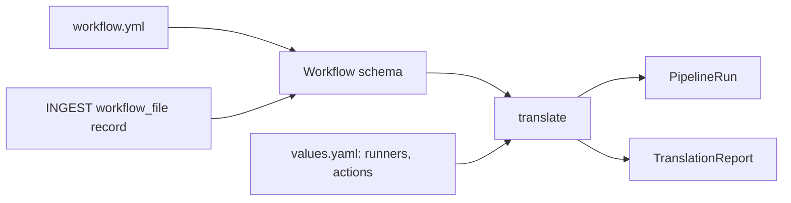

# gha-tekton

One GitHub Actions workflow in, one Tekton [Pipelines-as-Code](https://pipelinesascode.com)
`PipelineRun` out (`tekton.dev/v1`, pipeline and tasks inline), plus a report of everything
that did not translate 1:1. Typed end to end: the input against a hand-written schema of the
workflow keys GitHub accepts (an unknown key fails the render), the output against the
Tekton v1.16.0 CRD schemas in [`packages/providers/tekton`](../providers/tekton)
(`providers/registry.yaml`, row `tekton`).



## Usage

```bash
# from vendor/kcl-packages
kcl run packages/gha-tekton -D data=<workflow.yml> -D values=<values.yaml> -q > .tekton/<name>.yaml
kcl run packages/gha-tekton -D data=<workflow.yml> -D values=<values.yaml> -D report=true -q
kcl run packages/gha-tekton/main.k -q      # examples/workflow.yml + examples/values.yaml
```

| option | default | meaning |
| --- | --- | --- |
| `data` | `examples/workflow.yml` | a workflow file, or an INGEST `workflow_file` record (`contract_ingest::Record`, JSON): the workflow is `payload.content` |
| `values` | `examples/values.yaml` without `data`, else none | `Config` |
| `report` | `false` | render the `TranslationReport` instead of the PipelineRun |

The render **fails** while any construct is `unsupported`, listing them; `allowPartial: true`
in the values renders anyway (the report still lists them). `ignored` items (the token's
`permissions`, `workflow_dispatch`, matrix `fail-fast`/`max-parallel`, service `ports`) don't
change what a successful run does; `mapped` items are action mappings.

## Config

| key | default | |
| --- | --- | --- |
| `name` | file stem | PipelineRun name |
| `runners` | `ubuntu-*` → `docker.io/library/ubuntu:<v>` | `runs-on` label → image of every step of the job (a job `container.image` wins) |
| `actions` | `actions/checkout: {kind: checkout}` | `<owner>/<repo>[/<path>]` (no `@ref`) → `checkout`, `drop` (+ `reason`) or `step` (+ `image`, `script`; `with:` arrives as `INPUT_<NAME>`) |
| `gitImage` | `cgr.dev/chainguard/git:latest-dev` | checkout step image (git + POSIX shell) |
| `secretName` / `varsConfigMap` | `gha-secrets` / `gha-vars` | where `secrets.X` / `vars.X` are read from (key `X`) |
| `serviceAccountName` | `builder` | `taskRunTemplate.serviceAccountName` (gitops `platform/tekton/ci/builder.yaml`) |
| `workspaceSize`, `pipelineTimeout`, `maxKeepRuns` | `1Gi`, `6h`, `5` | |

**`setup-*` actions are a runner-image decision, not a step.** On GitHub they install a tool
into the machine every later step shares. Tekton steps are separate containers, so the
faithful translation is a runner image that already has the tool, with the action mapped to
`drop` and the reason stated (see `examples/values.yaml`).

## What translates

| GitHub | Tekton / PaC |
| --- | --- |
| `on.push` / `on.pull_request`: `branches` (globs), `branches-ignore`, `paths` | `pipelinesascode.tekton.dev/on-cel-expression` (`target_branch`, `.pathChanged()`) |
| `jobs.<id>` | `pipelineSpec.tasks[]` with `taskSpec` inline, workspace `source` at subPath `<id>` (jobs never share a checkout) |
| `needs`, `timeout-minutes` (default 360), `continue-on-error: true` | `runAfter`, `timeout`, `onError: continue` |
| `strategy.matrix` axes and `include` | `matrix.params` / `matrix.include` (beta; gitops sets `enable-api-fields: beta`) |
| `services` (`image`, `env`) | `sidecars`, reached on `localhost` |
| job `if`: `success()`, `github.event_name ==`/`!=`, `github.ref == 'refs/heads/<b>'`, joined by `&&` | `when` on `{{ event_type }}` / `{{ target_branch }}` |
| step `if`: the same subset | `( [ ... ] ) \|\| exit 0` after the `#!` line: a skipped step succeeds |
| `run` + `shell` (default `bash -e`, `bash` adds `pipefail`, `sh`, `python`) | step `script` with the same shebang and flags |
| `actions/checkout` (`fetch-depth`, `filter`, `submodules`, `path`, `ref`) | git step fed by PaC's `{{ git_auth_secret }}` (workspace `basic-auth`) |
| `${{ matrix.x }}` / `${{ github.sha }}` etc. | `$(params.x)` / PaC `{{ revision }}`, `{{ event_type }}`, `{{ repo_owner }}`, `{{ repo_name }}`, `{{ target_branch }}`, `{{ source_branch }}` |
| `${{ secrets.X }}` / `${{ vars.X }}` | env from Secret `secretName` / ConfigMap `varsConfigMap`; `secrets.GITHUB_TOKEN` from PaC's git auth Secret (`git-provider-token`) |
| `GITHUB_SHA`, `GITHUB_WORKSPACE`, `GITHUB_OUTPUT`, `GITHUB_STEP_SUMMARY`, `RUNNER_TEMP`, `CI` | `stepTemplate.env` |

## What does not (reported `unsupported`)

Other triggers (`schedule`: use a CronJob or Tekton Triggers), `tags`, `paths-ignore`,
non-default pull request `types`; reusable workflows; `environment`; `concurrency` (PaC sets
it on the `Repository`); job and step `outputs` (`steps.*`, `needs.*`), `$GITHUB_ENV` /
`$GITHUB_PATH`; expressions with functions or `||`; `secrets`/`vars` embedded in a longer env
value or inside single quotes in a script (they become shell variables, which would not
expand there); unmapped, local (`./`) and `docker://` actions with `with:`; checkout of
another repository; runners without an image.

## This repository's own workflows

`.github/workflows/ci.yml` reports 16 unsupported constructs: five unmapped `setup-*` actions,
the private `shluviza/toolkit` checkout (another repository, a token, `steps.*.outputs`), and
the Nx cache token chosen by `github.event_name == 'push' && secrets.A || secrets.B`.
`images.yml` reports 16 as well: `concurrency`, Google auth and Docker login actions, and the
`steps.*.outputs` its build gates on. The hand-written `.tekton/*.yaml` are image builds
(`buildkit-build`), not CI, so they are no golden output for either. Those reports are the
translator working as intended: each line names what a person must decide.

## Verification

`kcl test` (12 tests). The example's PipelineRun, with PaC's variables filled in, is accepted
by Tekton v1.16's admission webhook (`kubectl create --dry-run=server`).
