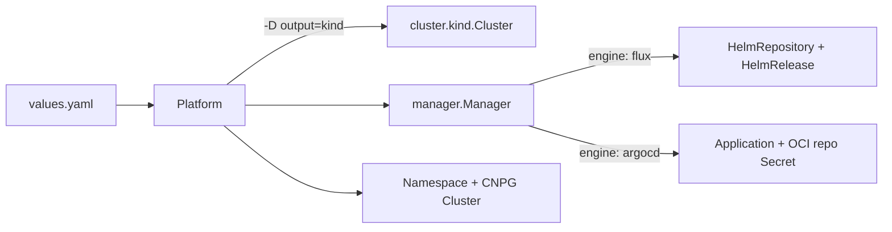

# local-platform

A local cluster and everything delivered onto it, from one values file. This
package is mostly composition: it imports other packages in this repo and
feeds them one typed `Platform` object.

| imported package | what it contributes |
| --- | --- |
| [`cluster`](../cluster) | `kind.Cluster`: nodes, ingress-ready control plane, the tainted `dedicated=database` pool |
| [`manager`](../manager) | `Dependency` rows, capability `bundles`, the `manager` / `application` type split, `role` filtering, dependency checks, the Flux render |
| [`app`](../app) | `mergeValues`, the deep right-wins merge behind every override |
| [`providers/argocd`](../providers/argocd), [`providers/cnpg`](../providers/cnpg) | typed CRD schemas for the Argo CD `Application` and the CNPG `Cluster` |



## Two generated apps

Both join `dependencies` as `application` rows, so they install on manager
and workload clusters. Each one generates default values; your map is
deep-merged over them. Maps merge key by key, and lists or scalars replace the
generated value. An explicit `dependencies` row with the same name replaces
the generated app entirely.

| field | app | renders | override |
| --- | --- | --- | --- |
| `postgres` | [CloudNativePG](https://cloudnative-pg.io) operator, chart `0.29.2` | the chart, **plus** the Namespace and the `postgresql.cnpg.io/v1 Cluster` holding the platform's state | `postgres.values` (chart), `postgres.database.spec` (Cluster spec, validated against the CRD) |
| `metricsServer` | [metrics-server](https://github.com/kubernetes-sigs/metrics-server), chart `3.14.0` | the chart only, with Kind-safe values (`--kubelet-insecure-tls`, small requests) | `metricsServer.values` |

When `cluster.dbWorkers > 0`, the CNPG Cluster is pinned to the Kind database
pool through a nodeSelector and a toleration. If you set
`postgres.database.dedicated: true` without that pool, the render fails
instead of leaving the pods Pending.

## Usage

`-D values=<path>` works like `helm -f`. `-D env=<name>` deep-merges
`<stem>.<name>.yaml` over the values file. `-D output=kind` renders the Kind
config instead of the manifests.

```bash
# the cluster
kcl run packages/local-platform -D values=packages/local-platform/examples/values.yaml -D output=kind -q \
  | kind create cluster --config -
# the charts: Flux (default), Argo CD, or a workload cluster
kcl run packages/local-platform -D values=packages/local-platform/examples/values.yaml -q
kcl run packages/local-platform -D values=packages/local-platform/examples/values.yaml -D env=argocd -q
kcl run packages/local-platform -D values=packages/local-platform/examples/values.yaml -D env=workload -q

just local-platform                                  # examples/values.yaml, manifests
just local-platform-up                               # kind + flux install + apply (twice)
```

In code: `import local_platform.lib as platform; platform.render(platform.Platform {**values})`.

The engine must already run on the cluster, because this package installs
neither Flux nor Argo CD. Under Flux, the CNPG `Cluster` is applied in the
same stream as its operator's HelmRelease, so on a new cluster you apply the
render a second time once `cloudnative-pg` is Ready. Under Argo CD, the Cluster
is placed one sync wave after the operator and annotated
`SkipDryRunOnMissingResource=true`. Application sync waves come from
`dependsOn` depth. They order the Applications only when a parent Application
syncs this stream and Argo CD's `argoproj.io/Application` health check is
enabled.
